<!-- cybertron288 · GitHub profile README · hero regenerated daily by today.py (.github/workflows/hero.yml) -->

<div align="center">
<picture>
  <source media="(prefers-color-scheme: dark)" srcset="./assets/tmux-dark.svg" />
  <source media="(prefers-color-scheme: light)" srcset="./assets/tmux-light.svg" />
  
</picture>
</div>

---

### `whoami`

```text
Ravi Patel  —  SDE-2 @ Healthlane Technologies
────────────────────────────────────────────────
• Core contributor to Zango — open-source Django framework
  powering enterprise healthcare apps across AstraZeneca,
  Pfizer, BMS, Roche & MSD.
• Building Igris — a governance layer for AI agents:
  policy engine, audit trail, and access control across
  LLM and MCP calls.
• From framework internals to AI governance infrastructure.
```

<p>
  🔭 <b>Zango</b> · open-source Django framework →
  <a href="https://github.com/Healthlane-Technologies/Zango">Healthlane-Technologies/Zango</a><br/>
  🛡️ <b>Igris</b> · governance for AI agents →
  <a href="https://igrisecurity.com/">igrisecurity.com</a>
</p>

---

### `stack`

**Frontend**


**Backend**


**Data & Infra**


**Mobile** · React Native · Expo &nbsp;•&nbsp; **Design** · Figma

---

### `contribution snake`

<div align="center">

<picture>
  <source media="(prefers-color-scheme: dark)" srcset="https://raw.githubusercontent.com/cybertron288/cybertron288/output/github-contribution-grid-snake-dark.svg" />
  <source media="(prefers-color-scheme: light)" srcset="https://raw.githubusercontent.com/cybertron288/cybertron288/output/github-contribution-grid-snake.svg" />
  
</picture>

</div>

---

### `find me`

<div align="center">

[](https://www.linkedin.com/in/ravipatel8407/)
[](mailto:ravipatel288.jobs@gmail.com)
[](https://igrisecurity.com/)

</div>
