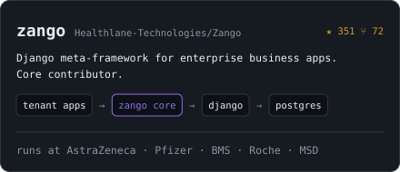
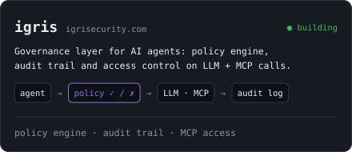

<!-- cybertron288 · GitHub profile README · SVGs in ./assets regenerated by hand: python today.py (needs ACCESS_TOKEN) -->

<a href="https://ravip-portfolio.vercel.app/">
<picture>
  <source media="(prefers-color-scheme: dark)" srcset="./assets/tmux-dark.svg" />
  <source media="(prefers-color-scheme: light)" srcset="./assets/tmux-light.svg" />
  
</picture>
</a>

---

### `work`

<a href="https://github.com/Healthlane-Technologies/Zango"><picture><source media="(prefers-color-scheme: dark)" srcset="./assets/card-zango-dark.svg" /><source media="(prefers-color-scheme: light)" srcset="./assets/card-zango-light.svg" /></picture></a>
<a href="https://igrisecurity.com/"><picture><source media="(prefers-color-scheme: dark)" srcset="./assets/card-igris-dark.svg" /><source media="(prefers-color-scheme: light)" srcset="./assets/card-igris-light.svg" /></picture></a>

<picture><source media="(prefers-color-scheme: dark)" srcset="./assets/activity-dark.svg" /><source media="(prefers-color-scheme: light)" srcset="./assets/activity-light.svg" /></picture>

---

### `find me`

