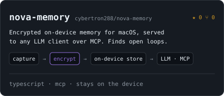
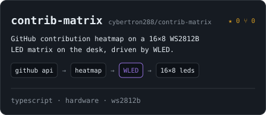
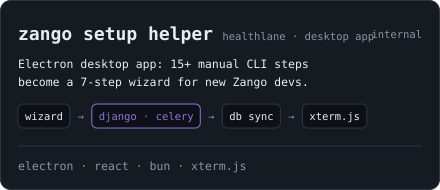

<!-- cybertron288 · GitHub profile README · SVGs in ./assets regenerated by hand: python today.py (needs ACCESS_TOKEN) -->

<a href="https://ravip-portfolio.vercel.app/">
<picture>
  <source media="(prefers-color-scheme: dark)" srcset="./assets/tmux-dark.svg" />
  <source media="(prefers-color-scheme: light)" srcset="./assets/tmux-light.svg" />
  
</picture>
</a>

---

### `work`

<a href="https://igrisecurity.com/"><picture><source media="(prefers-color-scheme: dark)" srcset="./assets/card-igris-dark.svg" /><source media="(prefers-color-scheme: light)" srcset="./assets/card-igris-light.svg" /></picture></a>
<a href="https://github.com/cybertron288/nova-memory"><picture><source media="(prefers-color-scheme: dark)" srcset="./assets/card-nova-memory-dark.svg" /><source media="(prefers-color-scheme: light)" srcset="./assets/card-nova-memory-light.svg" /></picture></a>
<a href="https://github.com/cybertron288/contrib-matrix"><picture><source media="(prefers-color-scheme: dark)" srcset="./assets/card-contrib-matrix-dark.svg" /><source media="(prefers-color-scheme: light)" srcset="./assets/card-contrib-matrix-light.svg" /></picture></a>
<picture><source media="(prefers-color-scheme: dark)" srcset="./assets/card-zango-setup-helper-dark.svg" /><source media="(prefers-color-scheme: light)" srcset="./assets/card-zango-setup-helper-light.svg" /></picture>

<picture><source media="(prefers-color-scheme: dark)" srcset="./assets/activity-dark.svg" /><source media="(prefers-color-scheme: light)" srcset="./assets/activity-light.svg" /></picture>

---

### `find me`

